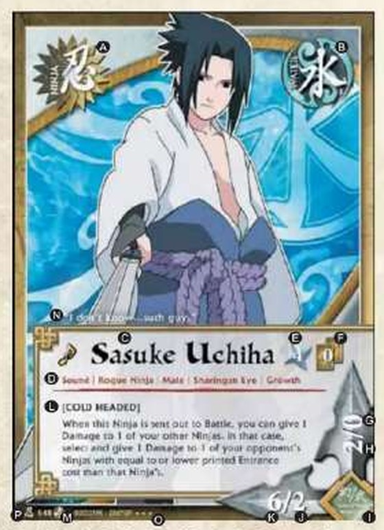
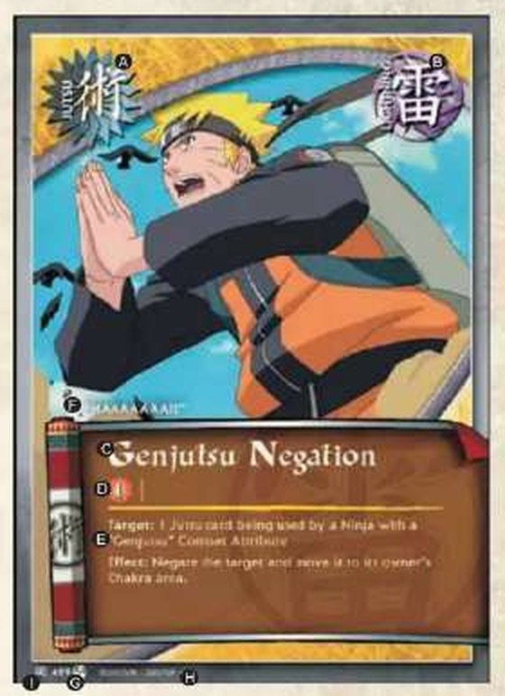
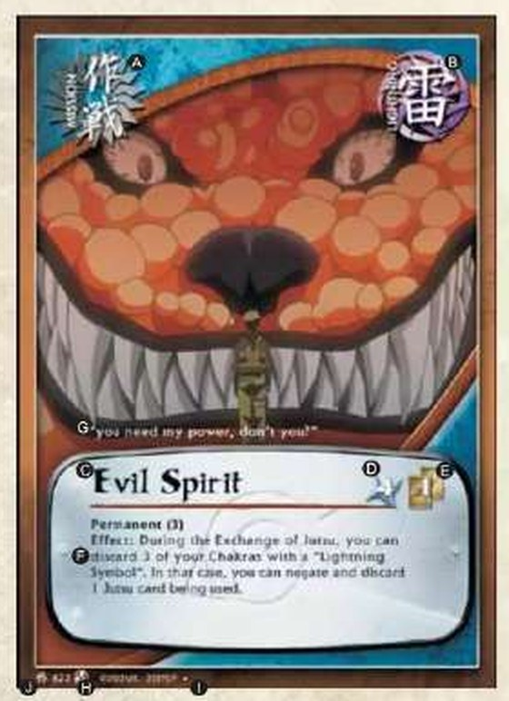
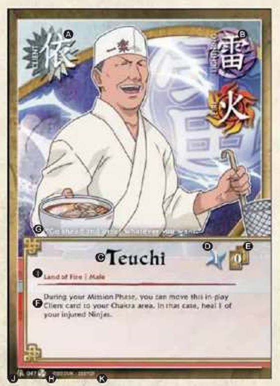
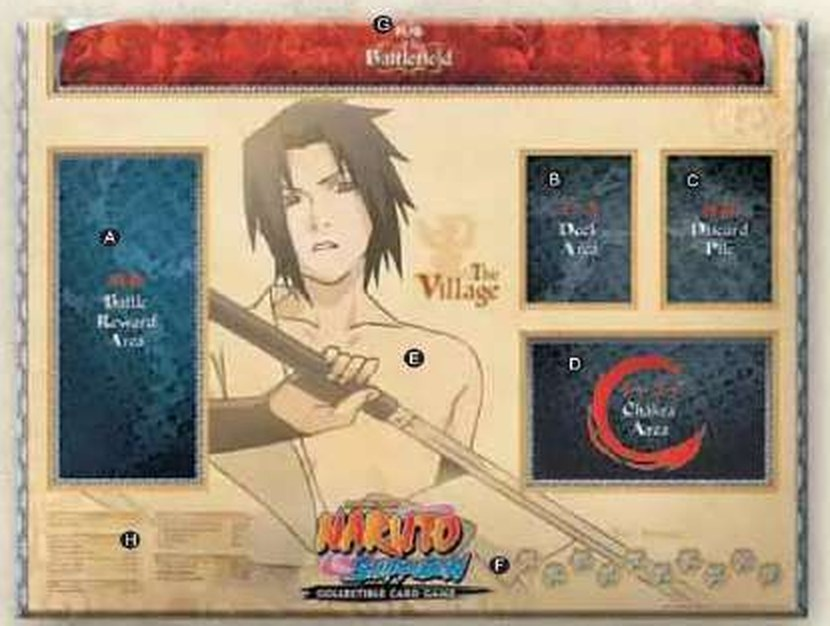

# Naruto CCG — Regras do Jogo

> Todas as regras do jogo num lugar só, juntando o manual antigo e o manual mais novo. Quando os dois discordam, vale o **mais novo**.
>
> Os termos em inglês entre colchetes [ ] são os que aparecem escritos nos cards.

---

## Sumário

1. [Apresentação dos Cards](#1-apresentação-dos-cards)
2. [Preparação para o Jogo](#2-preparação-para-o-jogo)
3. [Sequência de Jogo (Andamento do Turno)](#3-sequência-de-jogo-andamento-do-turno)
4. [Terminologia do Jogo](#4-terminologia-do-jogo)
5. [Efeitos dos Cards e Sequência (Chain) de Efeitos](#5-efeitos-dos-cards-e-sequência-chain-de-efeitos)
6. [Outras Regras e Características Especiais](#6-outras-regras-e-características-especiais)
7. [Criando um Deck](#7-criando-um-deck)
8. [Glossário PT ⇄ EN](#8-glossário-pt--en)
9. [O que mudou em relação ao manual antigo](#o-que-mudou-em-relação-ao-manual-antigo)

---

## 1. Apresentação dos Cards

Existem **4 tipos de cards**: **Ninja**, **Jutsu**, **Missão [Mission]** e **Cliente [Client]**.

### 1.1 Cards de Ninja

Representam os personagens únicos do universo de Naruto. Quando regras ou textos de cards dizem "Ninja(s)", referem-se a cards de Ninja. Durante a Fase de Batalha, Ninjas lançam ataques contra a Vila inimiga, lutam contra Ninjas inimigos ou protegem a própria Vila.

*As letras na imagem correspondem às da tabela abaixo.*

| Letra | Campo |
|---|---|
| A | Tipo do Card [Card Type] |
| B | Símbolo [Symbol] |
| C | Nome [Name] |
| D | Características [Characteristics] |
| E | Custo de Entrada [Entrance Cost] |
| F | Custo de Mão [Hand Cost] |
| G | Suporte (Ferido) [Support (Injured Status)] |
| H | Combate (Ferido) [Combat (Injured Status)] |
| I | Atributo de Combate [Combat Attribute] |
| J | Suporte (Saudável) [Support (Healthy Status)] |
| K | Combate (Saudável) [Combat (Healthy Status)] |
| L | Efeito [Effect] (ver [5.1](#51-efeitos-de-ninjas-e-clientes)) |
| M | Marca de Expansão [Expansion Mark] |
| N | Texto Ilustrativo [Flavor Text] |
| O | Raridade [Rarity] |
| P | Número do Card [Card Number] |

> **Combate** e **Suporte** juntos formam o **Poder [Power]** do Ninja. No card, o valor aparece como `Combate/Suporte` (ex.: `6/2`), com um par para o estado Saudável e outro para o estado Ferido.

### 1.2 Cards de Jutsu

Representam as artes Ninja. Usando Chakra, o poder de luta dos Ninjas pode ser ampliado ou Ninjas adversários podem ser atacados.

*As letras na imagem correspondem às da tabela abaixo.*

| Letra | Campo |
|---|---|
| A | Tipo do Card |
| B | Símbolo |
| C | Nome |
| D | Custo de Jutsu [Jutsu Cost] |
| E | Efeito / Alvo / Requerimento [Effect / Target / Requirement] (ver [3.5.3](#353-i-troca-de-jutsu-exchange-of-jutsu)) |
| F | Texto Ilustrativo |
| G | Marca de Expansão |
| H | Raridade |
| I | Número do Card |

### 1.3 Cards de Missão [Mission]

Representam eventos e tarefas do universo de Naruto. Seus efeitos variados podem dar vantagens importantes se usados com sabedoria. **Apenas um card de Missão pode ser jogado por turno** (ver regras completas em [3.3.2](#332-c-1-jogar-missão--2-jogar-contra-missão)).

*As letras na imagem correspondem às da tabela abaixo.*

| Letra | Campo |
|---|---|
| A | Tipo do Card |
| B | Símbolo |
| C | Nome |
| D | Custo de Entrada |
| E | Custo de Mão |
| F | Efeito / Alvo |
| G | Texto Ilustrativo |
| H | Marca de Expansão |
| I | Raridade |
| J | Número do Card |

### 1.4 Cards de Cliente [Client]

Representam os personagens que contratam os serviços das Vilas Ninja, ou pessoas comuns. **Clientes não podem ser enviados para a Batalha**, mas seus efeitos ajudam os Ninjas e a Vila. Quando regras ou textos dizem "Cliente(s)", referem-se a cards de Cliente.

*As letras na imagem correspondem às da tabela abaixo.*

| Letra | Campo |
|---|---|
| A | Tipo do Card |
| B | Símbolo (geralmente **dois** símbolos, ver [6.1](#61-símbolos-duplos)) |
| C | Nome |
| D | Custo de Entrada |
| E | Custo de Mão |
| F | Efeito |
| G | Texto Ilustrativo |
| H | Marca de Expansão |
| I | Características |
| J | Número do Card |
| K | Raridade |

---

## 2. Preparação para o Jogo

### 2.1 Itens essenciais

- **2 jogadores**: o jogo é um contra um.
- **Um Deck por jogador**, montado com cards de Naruto CCG:
    1. O Deck deve ter **exatamente 50 cards**.
    2. Você pode ter **qualquer quantidade** de cards de Ninja, Jutsu, Missão e/ou Cliente (regra válida desde a expansão *Will of Fire*).
    3. **No máximo 3 cards com o mesmo "nome"** no Deck (ver [6.11](#611-nome-de-um-card) para o que conta como "nome").
- **Baralho de Reforço [Reinforcement Deck]** (opcional): baralho extra de **até 15 cards** para os cards de Esquadrão [Squad] (ver [4.17](#417-baralho-de-reforço-reinforcement-deck)).
- **Painel de Jogo [Game Mat]**: um por jogador. Os dois painéis são unidos de forma que as áreas de **Campo de Batalha [Battlefield]** fiquem conectadas. O painel é **opcional**.
- **Marcador de Turnos [Turn Marker]** e **Moeda Ninja [Ninja Blade Coin]**: um de cada por jogador. Podem ser substituídos por moedas, clipes, dados etc. Uma moeda comum serve como Moeda Ninja.

### 2.2 Painel de Jogo (áreas)

*As letras na imagem correspondem às da tabela abaixo.*

| Letra | Área | Descrição |
|---|---|---|
| A | Área de Prêmios de Batalha [Battle Reward Area] | Onde ficam os Prêmios de Batalha obtidos durante a partida. |
| B | Área do Deck | Onde fica o seu Deck. |
| C | Pilha de Descartes [Discard Pile] | Onde ficam os cards descartados. |
| D | Área de Chakra | Cards que servem como Chakra para pagar custos de Jutsu. Todos os cards de Jutsu e Missão usados também vão para cá. |
| E | Vila [Village] | Onde ficam Ninjas, Clientes e Missões "Permanentes". |
| F | Indicador de Turnos [Turn Indicator] | Onde fica o Marcador de Turnos. Começa em "0" e sobe 1 no final de cada turno em que você for o Atacante. |
| G | Campo de Batalha [Battlefield] | Onde seus Times são enviados para a Batalha contra os Times do oponente. |
| H | Andamento do Jogo | Resumo impresso do fluxo do turno. |
| I | Baralho de Reforço [Reinforcement Deck] | Não aparece no painel. Cards de Esquadrão, **com a face para baixo**. |
| J | Área de Removidos de Jogo [Removed from Game Area] | Não aparece no painel. Cards removidos do jogo, **com a face para cima**. |

### 2.3 Preparativos

1. Junte os dois Painéis de Jogo. Coloque seu Deck na Área do Deck e seu Marcador de Turnos no **"0"** do Indicador de Turnos.
2. Embaralhe bem o seu Deck. Em seguida, embaralhe também o Deck do oponente.
3. Decida quem começa por um método aleatório (pedra-papel-tesoura, par-ou-ímpar ou lançar uma moeda). **O vencedor decide se será o primeiro a jogar ou não.**
4. Compre **6 cards** e coloque-os na mão.
    Se não gostar da mão, você pode trocá-la (*mulligan*):
    - A. Devolva a mão ao Deck e reembaralhe bem.
    - B. Entregue o Deck ao oponente, que também deve embaralhá-lo.
    - C. Compre **5 cards**.
    - D. Se também não quiser esses 5 cards, você tem **uma última chance**: repita A e B e compre **4 cards**.
5. Com a preparação concluída, a partida começa.

---

## 3. Sequência de Jogo (Andamento do Turno)

### 3.1 Visão geral

- Os jogadores **alternam turnos**.
- O jogador do turno é o **Atacante [Attacker]**; o outro é o **Bloqueador [Blocker]**.
- A maioria das ações é feita pelo Atacante. **Somente o Atacante pode lançar Ataques.** O Bloqueador pode tomar medidas defensivas.
- Cada jogador é Atacante em um turno e Bloqueador no seguinte.
- O jogo termina quando um jogador cumpre uma **Condição de Vitória**.

#### Condições de Vitória [Victory Conditions]

São verificadas na **Fase Final** (ver [3.6](#36-fase-final-end-phase)):

1. **10 ou mais Prêmios de Batalha** → o jogador vence ("ocasionou a destruição da Vila do oponente"). Se ambos tiverem 10 ou mais, **vence o Atacante** daquele turno.
2. **Sem cards no Deck** → o jogador perde ("a Vila esgotou seus recursos"). Se ambos estiverem sem cards no Deck, **perde o Atacante** daquele turno.

> A condição 1 é verificada primeiro: um jogador sem cards no Deck, mas com 10 ou mais Prêmios de Batalha, **vence**.

#### Resumo das fases

| Fase | Etapa | Quem age |
|---|---|---|
| **Fase Inicial** [Start Phase] | A. Comprar um card | Atacante |
| **Fase de Missão** [Mission Phase] | B. Baixar um Ninja | Atacante |
| | C. (1) Jogar Missão | Atacante |
| | C. (2) Jogar Contra-Missão [Counter Mission] | Bloqueador |
| | D. Carregar Chakra | Atacante |
| | E. Baixar um Cliente | Atacante |
| **Fase de Organização** [Organization Phase] | F. Organizar Times | Atacante |
| **Fase de Batalha** [Battle Phase] | G. Enviar Time(s) do Atacante | Atacante |
| | H. Enviar Time(s) do Bloqueador | Bloqueador |
| | I. Troca de Jutsu [Exchange of Jutsu] | Ambos |
| | J. Showdown | Ambos |
| | K. Retorno [Return] | Ambos |
| **Fase Final** [End Phase] | L. Decidir o vencedor | Ambos |
| | M. Ajustar a mão | Atacante |
| | N. Mover o Marcador de Turnos | Atacante |

### 3.2 Fase Inicial [Start Phase]

**A. Comprar um card.** O Atacante compra o card do topo do seu Deck.

- Efeitos que acontecem **"No Início do Turno" [At the Beginning of the Turn]** são aplicados **ANTES** da compra.
- **No primeiro turno do primeiro jogador, ele NÃO compra card**, mas realiza normalmente as demais etapas.

### 3.3 Fase de Missão [Mission Phase]

O Atacante pode realizar as ações abaixo **em qualquer ordem**:

- Baixar um Ninja
- Usar um card de Missão
- Carregar Chakra
- Baixar um Cliente

(O Bloqueador pode responder com uma Contra-Missão, ver C.(2).)

#### 3.3.1 B. Baixar [Deploy] um Ninja

O Atacante pode baixar em sua Vila um Ninja da mão, seguindo estas regras:

- **Apenas 1 Ninja pode ser baixado por turno.** Usar a **Emboscada [Ambush]** (ver [6.7](#67-emboscada-ambush)) conta como baixar um Ninja: no turno você baixa um Ninja da mão **ou** usa a Emboscada para trazer um Ninja da área de Chakra.
- **Você não pode ter dois Ninjas com o mesmo nome na sua Vila.** (Ex.: com um Sasuke Uchiha na Vila, você não pode baixar outro Sasuke Uchiha.) Ver também "Nome: X" em [6.11](#611-nome-de-um-card).
- Você **pode** baixar um Ninja mesmo que o oponente tenha um Ninja de mesmo nome na Vila dele.
- O **Custo de Entrada** do Ninja deve ser **igual ou menor** que o número indicado pelo seu Marcador de Turnos naquele momento. (Ex.: Iruka (Ninja-008), Custo de Entrada 2, só pode ser baixado com o Marcador em 2 ou mais.)
- Se o Ninja tiver **Custo de Mão 1 ou mais**, mova da mão para a área de Chakra a quantidade indicada de cards **com o mesmo Símbolo** do Ninja.
- Ninjas baixados entram **na vertical (Estado Saudável)**.
- Baixar um Ninja **não inicia** uma Sequência [Chain] de Efeitos, mas qualquer **Efeito de Entrar em Jogo [Come Into Play Effect]** do Ninja inicia uma Sequência logo em seguida. O oponente pode responder ao Ninja baixado com uma Contra-Missão ou com o efeito de um card, se o Tempo [Timing] de Resposta for correto (ver [5.2](#52-sequência-chain-de-efeitos)).

#### 3.3.2 C. (1) Jogar Missão / (2) Jogar Contra-Missão

O **Atacante** pode usar um card de Missão da mão, e o **Bloqueador** pode usar um card de **Contra-Missão [Counter Mission]** da mão dele. Regras:

- **Apenas 1 Missão por turno** pode ser jogada pelo Atacante.
- **Apenas 1 Contra-Missão por turno** pode ser jogada pelo Bloqueador.
- O **Custo de Entrada** da Missão deve ser igual ou menor que o número do Marcador de Turnos de quem a joga. (Ex.: Leaf Headband (Mission-003), Custo de Entrada 2, só pode ser jogada com o Marcador em 2 ou mais.)
- Se a Missão exige um **alvo específico**, o alvo válido deve ser escolhido ao jogar o card. **Sem alvo possível, a Missão não pode ser jogada.**
- Se a Missão tiver **Custo de Mão 1 ou mais**, mova da mão para a área de Chakra a quantidade indicada de cards com o mesmo Símbolo. Se a Missão tiver mais de um Símbolo, o jogador escolhe pagar com cards de um dos símbolos ou de ambos.
- Depois de jogada e com o efeito aplicado, a Missão vai para a **área de Chakra**.
    - Exceção: Missões **Permanentes** ficam Em Jogo na Vila (ver [6.4](#64-descrições-especiais-nos-textos-de-efeito)).
- Jogar uma Missão **inicia uma Sequência [Chain] de Efeitos**. O oponente pode responder com uma Contra-Missão ou com o efeito de algum card, se o Tempo de Resposta for correto (ver [5.2](#52-sequência-chain-de-efeitos)).

#### 3.3.3 D. Carregar Chakra [Charge Chakra]

Durante o próprio turno, o jogador pode mover cards da mão diretamente para a área de Chakra. Isso é **"Carregar Chakra"**.

- **Não há limite** de cards carregados por turno.
- Os efeitos dos cards movidos para a área de Chakra **não são aplicados** (exceto quando o próprio card disser o contrário).
- Cards movidos para a área de Chakra, ou que já estão lá, contam como **"Chakras"**.

> Missões e Jutsus também vão para a área de Chakra depois de jogados, com ou sem o efeito aplicado. **Isso não conta como "Carregar Chakra".**

#### 3.3.4 E. Baixar um Cliente [Deploy a Client]

O Atacante pode baixar um Cliente da mão em sua Vila. Regras:

- **Apenas 1 Cliente pode ser baixado por turno.**
- Você pode ter **qualquer número** de Clientes na Vila, desde que tenham **nomes diferentes** (regra válida desde a expansão *Will of Fire*). Se houver mais de 1 Cliente com o mesmo nome na mão, só 1 pode ser baixado. (Ex.: com uma Tsunami na Vila, você não pode baixar outra Tsunami.)
- Você **pode** baixar um Cliente mesmo que o oponente tenha o mesmo Cliente na Vila dele.
- O **Custo de Entrada** do Cliente deve ser igual ou menor que o número do seu Marcador de Turnos.
- Se o Cliente tiver **Custo de Mão 1 ou mais**, mova da mão para a área de Chakra a quantidade indicada de cards com o mesmo Símbolo. O jogador escolhe qual (ou quais) dos símbolos do Cliente usar.
- **Baixar um Cliente não conta no limite de "1 Ninja por turno".**
- Baixar um Cliente **não inicia** uma Sequência, mas qualquer Efeito de Entrar em Jogo inicia uma Sequência logo a seguir. O oponente pode responder com uma Contra-Missão ou efeito de card, se o Tempo de Resposta for correto.
- Depois de Em Jogo, um Cliente **só sai por efeito de card**.

### 3.4 Fase de Organização [Organization Phase]

#### F. Organizar Times

No **início** da Fase de Organização, o Atacante **desmonta TODOS os seus Times**. Depois, organiza os Ninjas da sua Vila em Times:

- Cada Time tem de **1 a 3 Ninjas**.
- **Não há limite** de número de Times.
- **TODOS os Ninjas da Vila devem fazer parte de algum Time.**

> Ex.: com 4 Ninjas na Vila: 4 Times de 1; 2 Times de 2; 1 Time de 3 + 1 Time de 1; ou 1 Time de 2 + 2 Times de 1.

Depois de organizados, os Times **não podem ser alterados até a sua próxima Fase de Organização**.

### 3.5 Fase de Batalha [Battle Phase]

> **A Fase de Batalha não acontece no primeiro turno do primeiro jogador.** Ele vai direto para a Fase Final.

Ordem:

1. Enviar Time(s) do Atacante
2. Enviar Time(s) do Bloqueador
3. Troca de Jutsu [Exchange of Jutsu]
4. Showdown
5. Retorno [Return]

#### 3.5.1 G. Enviar [Send out] Time(s) do Atacante

O Atacante pode enviar Times à Batalha movendo-os para o seu Campo de Batalha. Também pode escolher **não atacar**.

1. Decida quais Times enviar: **até 3 Times por turno** (ou nenhum).
2. Em cada Time, escolha o **Ninja Líder [Head Ninja]**. Os demais são **Ninjas de Apoio [Back Ninjas]** e ficam em linha atrás do Líder. Num Time de 1 Ninja, ele é o Líder.

Essa formação **não pode ser mudada durante o turno**, a não ser que um efeito de card permita.

#### 3.5.2 H. Enviar [Send out] Time(s) do Bloqueador

O Bloqueador pode enviar Times ao Campo de Batalha para **bloquear** os Times do Atacante, ou não bloquear.

1. Decida qual Time enviar (ou nenhum).
2. Decida **qual Time Atacante** ele bloqueia. **Cada Time Bloqueador só pode bloquear 1 Time Atacante.** Por isso o Bloqueador nunca envia mais Times do que o Atacante enviou.
3. Escolha o **Ninja Líder** do Time; os demais viram Ninjas de Apoio, em linha atrás dele. Num Time de 1 Ninja, ele é o Líder. A formação não muda durante o turno, salvo efeito de card.
4. Se houver outro Time Atacante, volte ao passo 1 para o próximo bloqueio. Quando todos os Times Atacantes estiverem bloqueados, ou o Bloqueador decidir parar, siga para a Troca de Jutsu.

Definições:

- **Em Combate [Battling]**: um Time Atacante bloqueado e o Time Bloqueador que o bloqueou.
- **Fora de Combate [Non-Battling]**: Time Atacante que não foi bloqueado.
- **Ninjas Reserva [Stand-By Ninjas]**: Ninjas de Times que não foram enviados naquele turno. Eles ficam nas suas Vilas.

#### 3.5.3 I. Troca de Jutsu [Exchange of Jutsu]

Os Ninjas no Campo de Batalha podem usar cards de Jutsu da mão de seus jogadores. Cada Jutsu usado entra numa **Sequência [Chain] de Efeitos** e seu efeito é aplicado na **Resolução da Sequência** (ver [5.2](#52-sequência-chain-de-efeitos)).

##### Como usar cards de Jutsu

1. **Definir o Usuário [User].** Escolha um dos seus Ninjas **no Campo de Batalha**. **Ninjas Reserva e Clientes não podem usar Jutsu.** Jutsus com **Requerimento [Requirement]** só podem ser usados por Ninjas que atendam ao requerimento. O requerimento é verificado **quando o Jutsu é usado e de novo quando vai ser resolvido**. O Ninja escolhido é o Usuário até o efeito ser aplicado.
2. **Pagar o Custo de Jutsu** com cards da área de Chakra (os cards pagos vão para a Pilha de Descartes):
    - Se o custo tiver **símbolos específicos**, descarte Chakras com esses símbolos.
    - Se o custo tiver um **número**, descarte essa quantidade de Chakras de qualquer símbolo.
    - **Não é permitido descartar mais Chakras do que o custo pede.**
    - Ex.: custo `火 ①` → descarte 1 card com símbolo de Fogo + 1 card qualquer (total 2).
    - **Custo com "X"**: pague primeiro a parte que não é X. Depois defina o valor de X e mova essa quantidade de cards da área de Chakra para a Pilha de Descartes. Isso **não faz parte do custo**, é uma etapa extra. Se houver mais de um "X", todos têm o mesmo valor, e para cada "X" move-se essa quantidade de Chakras. X pode ser qualquer número **exceto 0**.
3. **Definir o Alvo [Target].**
    - Jutsu com **Alvo**: escolha o alvo específico do efeito.
    - Jutsu sem Alvo: não precisa escolher.
    - O alvo é verificado **quando o Jutsu é jogado e de novo quando vai ser resolvido**.

Se tudo isso ocorrer sem problemas, o uso está completo e o card entra na Sequência como **"card de Jutsu sendo usado" [Jutsu card in Use]**.
Se alguma condição não for cumprida (ou o custo não puder ser pago), o efeito não pode ser usado e **o card volta para a mão do dono**.

- Durante a Troca de Jutsu, Sequências podem ser geradas **quantas vezes se quiser** no turno.
- **A Troca de Jutsu termina quando ambos os jogadores declaram que não vão gerar mais Sequências.** Então segue-se para o Showdown.

#### 3.5.4 J. Showdown

As Batalhas entre os Times enviados em (1) e (2) são processadas **uma de cada vez**. **O Atacante decide a ordem** em que seus Times são processados, estejam Em Combate ou Fora de Combate.

**Poder do Time [Team Power] = Combate do Ninja Líder + Suporte de cada Ninja de Apoio**
(Com dois Ninjas de Apoio, some o Suporte de AMBOS ao Combate do Líder.)

**Batalha Mental [Mental Power Battle]**: quando indicada, use o **Poder Mental do Time = soma do Poder Mental de todos os Ninjas do Time**, com as mesmas regras abaixo trocando "Poder do Time" por "Poder Mental do Time".

O processamento é diferente para Times Fora de Combate e Em Combate:

##### Times Fora de Combate [Non-Battling]

O ataque não foi impedido. O Time recebe **Prêmios de Batalha** conforme o Poder do Time:

| Poder do Time | Resultado |
|---|---|
| **4 ou menos** | **Prêmio de Batalha Normal**: pegue **1 card** do topo do Deck do oponente e coloque-o na sua Área de Prêmios de Batalha, **com a face para baixo** (ninguém vê o card). |
| **5 ou mais** | **Prêmio de Batalha Espetacular [Outstanding]**: pegue **2 cards** do topo do Deck do oponente para a sua Área de Prêmios, com a face para baixo. |

##### Times Em Combate [Battling]

Compare o Poder dos dois Times:

| Diferença de Poder | Resultado |
|---|---|
| **1 a 4** | **Vitória / Derrota**: o Time com menos Poder é derrotado. O **Ninja Líder** derrotado recebe **1 Dano**. |
| **5 ou mais** | **Vitória Espetacular / Derrota Completa**: o Time com menos Poder é completamente derrotado. O **Ninja Líder** recebe **2 Danos** e **cada Ninja de Apoio** recebe **1 Dano**. |
| **0 (igual)** | **Empate [Draw]**: os **Ninjas Líderes dos dois Times** recebem **1 Dano** cada. |

Esse processo é o **"Showdown"** e se aplica a todos os Times enviados.

##### Dano [Damage] e Ninjas Feridos [Injured Ninjas]

- Ninjas ficam normalmente **na vertical = Estado Saudável [Healthy Status]** (Ninjas Saudáveis).
- Ao receber **1 Dano**, ficam **na horizontal = Estado Ferido [Injured Status]** (Ninjas Feridos).
- Um Ninja Ferido que recebe outro Dano é **Nocauteado [Knocked Down]** e **descartado**.
- Um Ninja Saudável que recebe **2 Danos** pula o Estado Ferido e é **nocauteado e descartado** na hora.

Desvantagens do Ninja Ferido:

1. Passam a valer os valores de **Combate (Ferido)** e **Suporte (Ferido)**.
2. O **texto de efeito do Ninja é negado**. Exceção: efeitos precedidos por **"Válido" [Valid]** continuam valendo.

**Curar [Heal]**: certos efeitos devolvem um Ninja Ferido ao Estado Saudável. Ao curar, gire o card de volta para a vertical.

#### 3.5.5 K. Retorno [Return]

Depois do Showdown, todos os Times no Campo de Batalha **voltam para suas Vilas** e viram **Ninjas Reserva**, **mantendo o estado atual** (quem foi ferido continua Ferido). Ninjas que sofreram 2 Danos e foram descartados não voltam.

### 3.6 Fase Final [End Phase]

**L. Decidir o vencedor.** Verifique as [Condições de Vitória](#condições-de-vitória-victory-conditions). Se ninguém venceu, siga para M.

**M. Ajustar a mão.** Se o **Atacante** tiver **7 ou mais cards** na mão, ele descarta até ficar com **6**. Com 6 ou menos, nada acontece. **O Bloqueador nunca descarta**, mesmo com 7 ou mais cards.

**N. Mover o Marcador de Turnos.** O Atacante avança seu Marcador de Turnos **1 casa**. Efeitos **"No Final do Turno" [At the End of the Turn]** são aplicados **depois** de mover o Marcador.

Se ainda não houver vencedor, começa um novo turno: o Atacante passa a ser o Bloqueador, e vice-versa.

---

## 4. Terminologia do Jogo

### 4.1 Sua Vila [Village]
Onde ficam seus Ninjas e Clientes Em Jogo [In Play] enquanto não estão em Batalha. Todos os cards ficam **com a face para cima**.

### 4.2 A Vila do Oponente
Onde ficam os Ninjas e Clientes Em Jogo do oponente enquanto não estão em Batalha. Face para cima.

### 4.3 Mão [Hand]
Seus cards ficam virados para você, com o verso para o oponente. Você não pode ver a mão do oponente, mas **pode contar** quantos cards ele tem.

### 4.4 Prêmio de Batalha [Battle Reward]
Cards na Área de Prêmios de Batalha. Obter 10 é uma Condição de Vitória. São obtidos com ataques bem-sucedidos. Ficam **com a face para baixo**: **nenhum jogador pode vê-los**, mas podem ser contados.

### 4.5 Chakra
Cards na área de Chakra, usados para pagar custos de Jutsu. Ficam **com a face para cima** e qualquer jogador pode examiná-los.

### 4.6 Carregar [Charge] Chakra
Mover cards da mão para a área de Chakra. Cards carregados vão **sempre para a área de Chakra do Dono** do card.

### 4.7 Cards Descartados
Cards descartados, movidos ou enviados para a Pilha de Descartes. **Face para cima**, e qualquer jogador pode examiná-los.

### 4.8 Baralho [Deck]
Os cards do Deck ficam **sempre com a face para baixo**. Ninguém, nem o dono, pode virar o Deck ou os cards de forma que as faces fiquem visíveis, seja durante o jogo, seja ao embaralhar. Qualquer jogador pode **contar** os cards de qualquer Deck, mas **não pode mudar a ordem** deles.

### 4.9 "Dono [Owner] Original" e "Seu Card [Your Card]"
- **Dono Original**: o jogador que tinha o card no Deck no início do jogo. **Nunca muda.**
- **"Seus Cards"**: cards na sua Vila ou no seu lado do Campo de Batalha. Você tem o direito de manuseá-los.
- Se um efeito move um card para a Vila do oponente, ele passa a ser "Seu Card" do oponente enquanto estiver na mesa.
- Cards movidos para Chakra, Pilha de Descartes, Deck ou Mão vão **sempre** para a respectiva área **do Dono Original**.

### 4.10 Hierarquia [Rank]
Muitos Ninjas têm uma Hierarquia nas Características. Do menor para o maior:

**Estudante da Academia [Ninja Academy Student] > Genin > Chunin > Jonin Especial [Special Jonin] / Anbu > Jonin > Satoosa [Líder da Vila] / Sannin**

- "Genin ou Hierarquia Inferior" [Genin or lower Rank] inclui Estudante da Academia e Genin.
- "Chunin ou Hierarquia Superior" [Chunin or higher] inclui Chunin, Jonin Especial, Anbu, Jonin, Satoosa e Sannin.
- **Jonin Especial e Anbu** são do mesmo nível, e **Sannin e Satoosa** também.
- **"Ninja Hunter" e "Rogue Ninja" não são Hierarquias.** Se o card tiver algo como "(Chunin)", o Ninja é considerado dessa Hierarquia.
- **Animais e Ninjas não humanos não têm Hierarquia** e normalmente não têm gênero.

### 4.11 Atributos de Combate [Combat Attributes]
Indicam o método de combate do Ninja. Exemplos (há muitos outros):

| | | | |
|---|---|---|---|
| 忍 Ninjutsu | 武 Weapon | 精 Mind | 牙 Fang |
| 幻 Genjutsu | 炎 Flame | 影 Shadow | 蟲 Insect |
| 体 Taijutsu | 霧 Mist | 食 Food | 氷 Ice |

### 4.12 X
Indica "qualquer número". **Em custo de Jutsu**, X pode ser qualquer número **exceto 0**, e não é considerado parte do custo, mas uma quantidade extra de cards descartada depois que o custo é pago (ver [3.5.3](#353-i-troca-de-jutsu-exchange-of-jutsu)).

### 4.13 (+X/-X)
Adição ou subtração ao Poder do Ninja, na ordem **Combate / Suporte**.

### 4.14 "Genin", "Folha [Leaf]" etc.
"Genin" indica Ninjas e Clientes com "Genin" nas Características. Da mesma forma, "Leaf" indica a Característica "Leaf".
**"Genin" + "Male"** indica quem tem as **duas** Características.

### 4.15 Poder Mental [Mental Power]: X
Nível de conhecimento e proficiência acadêmica do Ninja, usado em Batalhas Mentais. Ninjas sem "Mental Power: X" têm **Poder Mental 0**. O Poder Mental **não muda quando o Ninja está Ferido**.

### 4.16 Showdown / Negar / Batalha Mental / Moeda / Embaralhar
- **Showdown**: o cálculo dos resultados da Batalha entre os Times enviados na Fase de Batalha.
- **Negar [Negate]**: o efeito do card não é aplicado. **O custo pago é perdido.** Se só o efeito de um card for negado, o custo pago por aquele efeito também é perdido.
- **Batalha Mental [Mental Power Battle]**: Showdown calculado com o Poder Mental do Time no lugar do Poder do Time.
- **Jogar a Moeda Ninja [Flip]**: decida qual lado é Cara [Heads] e qual é Coroa [Tails] e jogue a moeda a pelo menos ~10 cm de altura, fazendo-a girar várias vezes.
- **Embaralhar [Shuffle]**: deixar o Deck em ordem aleatória. Depois de embaralhar o seu Deck, peça ao oponente para reembaralhá-lo.

### 4.17 Baralho de Reforço [Reinforcement Deck]
Baralho extra de **até 15 cards** que fica fora do Painel de Jogo (o local é combinado antes da partida). Por enquanto **só cards de Esquadrão [Squad]** vão nele, mas outros tipos podem vir a ser permitidos.
- Máximo **3 cópias de um Esquadrão com o mesmo nome**. Dá para combinar 3 Esquadrões diferentes de mesmo nome para chegar a esse total.
- Cada jogador tem o seu. Os cards ficam **face para baixo** e só o controlador pode vê-los, mas **qualquer jogador pode contar** quantos cards há ali.

### 4.18 Área de Removidos de Jogo [Removed from Game Area]
Área fora do Painel (o local é combinado antes da partida) para os cards **removidos do jogo**. Cada jogador tem a sua. Cards ali ficam **face para cima** e qualquer jogador pode conferi-los. Só voltam ao jogo naquela partida se algum efeito permitir.

### 4.19 Fora de Jogo [Removed from Play]
Ninjas, Clientes ou Missões Permanentes Em Jogo que são **movidos para qualquer outra zona** são considerados Fora de Jogo. Isso inclui cards movidos, descartados ou Removidos de Jogo, e também os **descartados pelo resultado do Showdown**.
Cards que **mudam de controle** e vão para a área do oponente **continuam Em Jogo** durante essa mudança.

### 4.20 Marcador de Veneno [Poison Coin]
Um Ninja com algum Marcador de Veneno **não pode ser Enviado para a Batalha**.

---

## 5. Efeitos dos Cards e Sequência (Chain) de Efeitos

### 5.1 Efeitos de Ninjas e Clientes

- O efeito de um **Ninja** vale enquanto ele estiver **Em Jogo e Saudável**. Efeitos precedidos por **"Válido" [Valid]** valem mesmo com o Ninja Ferido.
- O efeito de um **Cliente** Em Jogo vale **sempre**.

Uso de efeitos de Ninjas ou Clientes na Vila ou no Campo de Batalha:

1. Só podem ser usados **enquanto estiverem Em Jogo**, salvo indicação no card.
2. Só podem ser usados **no momento adequado**.
3. Se o efeito diz que o jogador **"pode" [can]** fazer algo, ele pode ser usado **apenas uma vez por turno**.
4. Para usar, o jogador **declara** o efeito. O efeito inteiro entra numa **Sequência [Chain] de Efeitos** e só é aplicado na Resolução.
5. Efeitos de Ninjas/Clientes **não têm "custo" para ativar**. Todas as ações indicadas no card só acontecem quando o efeito resolve.

### 5.2 Sequência [Chain] de Efeitos

Uma Sequência é desencadeada quando:
- um efeito de Ninja ou Cliente é ativado;
- um card de Jutsu é usado;
- um card de Missão é jogado; ou
- um efeito de Missão Permanente é ativado.

Durante a Sequência, outro efeito pode ser usado **em resposta**, se o **Tempo [Timing] de Resposta** for correto. O efeito usado em resposta é aplicado **antes** do anterior.

1. Quando um efeito é usado, abre-se uma Sequência.
    - **O Atacante escolhe primeiro** se vai usar um efeito. Nas Sequências seguintes, os jogadores **se alternam** na escolha de quem usa primeiro.
2. Cada jogador decide se responde com outro efeito. Se **ambos** quiserem responder ao mesmo tempo, **tem prioridade o jogador que NÃO usou o efeito imediatamente anterior**.
    - Ao usar um novo Jutsu na Sequência, o Usuário pode ser **qualquer um dos seus Ninjas no Campo de Batalha** (não precisa ser o mesmo do Jutsu anterior).
3. Repita o passo 2 até **ambos** declararem que não usarão mais efeitos. Então vai-se para a Resolução.

> Mesmo um único efeito sem resposta forma uma Sequência.

#### Resolução da Sequência [Resolution of a Chain]

- Os efeitos são aplicados **na ordem inversa** em que foram usados: do último para o primeiro.
- Jutsus e Missões não Permanentes vão para a **área de Chakra de quem os usou** assim que o efeito é aplicado.
- Se, na hora de resolver, algum **Requerimento, Alvo ou Efeito for inválido**, o card **falha** e o efeito não é aplicado. Jutsus e Missões não Permanentes que falham também vão para a área de Chakra. **Os custos pagos não são devolvidos.**

Casos específicos:

- Se o **Ninja Usuário de um Jutsu sair do jogo** antes da resolução, o Jutsu falha e vai para a área de Chakra.
- Um Jutsu usado cujo efeito não foi aplicado **ainda conta como usado**. Os custos não voltam.
- Se uma Missão ou Jutsu tem **vários alvos** e alguns saíram do jogo (ou deixaram de ser alvos válidos), **os alvos restantes são afetados** normalmente.
- Se **todos os alvos** saíram do jogo, a Missão ou Jutsu falha e vai para a área de Chakra.
- Se o efeito de um Ninja foi para a Sequência e **o Ninja saiu do jogo** antes da resolução, o efeito falha.
- Se o efeito de um Ninja **sem "Valid:"** foi para a Sequência e **o Ninja ficou Ferido** antes da resolução, o efeito falha.

Sequências podem ser geradas **quantas vezes se quiser** no mesmo turno.

---

## 6. Outras Regras e Características Especiais

### 6.1 Símbolos Duplos
A maioria dos Clientes e Pelotões [Platoons], e alguns cards de Missão, Ninja e Jutsu, têm **dois símbolos**, que são intercambiáveis. Ao usar o card como Chakra (ou para pagar Custo de Mão), o jogador escolhe o símbolo que preferir. **Mesmo assim, o card não conta como dois Chakras.**

### 6.2 Times com 4 ou mais Ninjas
Se um efeito deixar um Time com 4 ou mais Ninjas, nada acontece até a sua Fase de Organização. Nela, o Time é dissolvido e reorganizado com no máximo 3 Ninjas.

### 6.3 Ninjas e Clientes com o mesmo nome em jogo
Ver [3.3.1](#331-b-baixar-deploy-um-ninja), [3.3.4](#334-e-baixar-um-cliente-deploy-a-client) e [6.11 (B)](#611-nome-de-um-card).

### 6.4 Descrições especiais nos textos de efeito

- **Válido [Valid]:** o efeito do Ninja vale mesmo com ele Ferido.
- **Requerimentos [Requirements]:** condições para usar um Jutsu. Um Ninja que não as cumpre não pode usar o Jutsu. Verificados quando o Jutsu é usado e quando vai ser resolvido.
- **Alvo [Target]:** o alvo do card. **Se não existir alvo válido, o card não pode ser usado.** Alguns cards têm 2 ou mais alvos. O alvo de um Jutsu é verificado quando ele é usado e quando vai ser resolvido.
- **Efeito [Effect]:** o efeito do card. Termos usados:
    - **Curar [Heal]**: devolve Ninjas do Estado Ferido ao Saudável.
    - **Anulação [Counter]**: Missões com essa descrição **só podem ser usadas durante o turno do oponente** (são as Contra-Missões, ver [3.3.2](#332-c-1-jogar-missão--2-jogar-contra-missão)).
    - **Permanente [Permanent]**: ao ser usada, a Missão é **colocada na Vila do jogador** em vez de ir para a área de Chakra. O efeito vale **enquanto ela estiver em jogo**.
    - **Permanente (X) [Permanent (X)]**: ao ser usada, a Missão vai para a Vila **com X Moedas Ninja** sobre ela. **No início de cada turno seu**, remova uma moeda. Ao remover a última, a Missão vira Chakra e vai para a área de Chakra do dono. O efeito vale enquanto ela estiver em jogo.

### 6.5 Crescimento [Growth]

Se você tem um Ninja com a Característica **Growth** na mão durante a sua Fase de Missão, pode colocá-lo em jogo **no lugar de um Ninja de mesmo nome na sua Vila**.

- O Ninja substituído **vira Chakra**.
- Coloque uma **Moeda Ninja** (o "**Marcador de Crescimento**" [Growth Coin]) sobre o novo Ninja. Cada Marcador de Crescimento dá **+1/+1**.
- **Não é preciso pagar Custo de Mão** para colocar o Ninja via Crescimento.
- Ninjas que **já têm** Marcador de Crescimento **não podem ser substituídos** por Crescimento.
- O novo Ninja **herda o estado** (Saudável/Ferido) do original. Efeitos de Alvo, Moedas e quaisquer outros efeitos que estejam afetando o original também passam para o novo Ninja (exceto o Marcador de Crescimento, que nunca é herdado).
- Crescimento **não conta como baixar um Ninja**: pode ser feito **quantas vezes quiser** no turno.
- **Um Ninja que entrou na Vila neste turno não pode ser substituído por Crescimento neste mesmo turno.**

### 6.6 Pelotão [Platoon]

Se você tem um Ninja com a Característica **Platoon** na mão durante a sua Fase de Missão, pode colocá-lo em jogo **no lugar de um Ninja da sua Vila que tenha um dos nomes indicados no Pelotão**.

- O **Custo de Entrada** do Pelotão deve ser igual ou menor que o seu Marcador de Turnos.
- **Custo de Mão 1 ou mais**: mova da mão para o Chakra a quantidade indicada de cards com o mesmo símbolo do Pelotão. Você escolhe qual dos símbolos usar.
- O Ninja substituído **vira Chakra**. Efeitos de Alvo, Moedas ou quaisquer outros que estavam no original são **eliminados** (não passam para o Pelotão).
- O Pelotão entra **sempre Saudável**, ignorando o estado do Ninja substituído.
- **Não conta como baixar um Ninja**: não há limite de Pelotões por turno. Mas **só se pode substituir um Pelotão por outro Pelotão se o segundo tiver nome diferente** do primeiro.
- Se um card pede Hierarquia, Atributo de Combate ou Característica (por exemplo, como Requerimento) e o Pelotão tem vários desses parâmetros, ele é considerado **com todos eles**.
- **Diferente do Crescimento**, um Ninja que entrou na Vila neste turno **pode** ser substituído por um Pelotão no mesmo turno.
- Se você tem **na Vila os dois Ninjas** indicados no Pelotão, **não pode** substituir nenhum deles por esse Pelotão.
- Cada Pelotão continua limitado a **3 cópias por nome** no Deck.
- Pelotões **só entram em jogo substituindo um Ninja** dessa forma. Nenhum outro efeito pode colocá-los diretamente em jogo.

### 6.7 Emboscada [Ambush]

Se você tem um Ninja com a Característica **Ambush** na sua **área de Chakra** durante a sua Fase de Missão, pode **Baixá-lo** a partir dali.

- Usar a Emboscada **conta como Baixar um Ninja**, então segue a regra de **1 Ninja por turno**.
- Todos os custos (**Custo de Entrada e Custo de Mão**) devem ser respeitados normalmente.

### 6.8 Esquadrão [Squad]

Esquadrões são cards de Ninja mantidos no **Baralho de Reforço**, não no Deck.

- Máximo **3 cópias por nome** no Baralho de Reforço. Dá para combinar até 3 Esquadrões diferentes de mesmo nome.
- Todo Esquadrão tem a Característica **Squad**.
- Esquadrões **nunca podem ir para a mão** de nenhum jogador.
- Um efeito que permite procurar um Ninja **no Deck** não permite procurar no Baralho de Reforço, a menos que diga isso explicitamente.

**Formar um Esquadrão** (só o Atacante, durante a própria Fase de Missão):

1. O **Custo de Entrada** do Esquadrão deve ser igual ou menor que o seu Marcador de Turnos.
2. Pague o **Custo de Mão** (cards da mão com o mesmo símbolo vão para o Chakra).
3. Você deve ter **em jogo 1 cópia de cada um dos Ninjas indicados** no Esquadrão. **Se tiver mais de 1 cópia de algum deles em jogo, o Esquadrão não pode ser formado.**
4. Mova esses Ninjas para a **Área de Removidos de Jogo do dono** deles.
5. Mova o Esquadrão do Baralho de Reforço para a sua **Vila**.

Regras adicionais:

- Não é possível formar um Esquadrão usando como base um Esquadrão em jogo **com o mesmo nome**.
- É possível formar um Esquadrão a partir de **outros Esquadrões** em jogo, desde que cada um tenha um nome que faça parte do nome do Esquadrão a ser formado.
- **Pelotões com vários nomes** podem ser usados como se fossem Ninjas com esses nomes.

    > Ex.: para formar "Naruto Uzumaki & Sasuke Uchiha", você pode remover: um Pelotão que inclua Naruto Uzumaki + um Ninja individual Sasuke Uchiha; ou um Pelotão chamado "Naruto Uzumaki & Sasuke Uchiha"; ou um Pelotão com Sasuke Uchiha + outro Esquadrão com Naruto Uzumaki; ou um Esquadrão com Naruto Uzumaki + outro Esquadrão com Sasuke Uchiha. **Não** é permitido remover um Esquadrão "Naruto Uzumaki & Sasuke Uchiha" para formar outro Esquadrão "Naruto Uzumaki & Sasuke Uchiha".

- Pode-se formar **quantos Esquadrões quiser** na Fase de Missão, inclusive usando Ninjas que entraram em jogo naquele turno.
- **Efeitos também podem colocar Esquadrões em jogo.**
- Quando um Esquadrão entra em jogo, ativam-se os efeitos que seriam ativados quando "um Ninja é colocado em jogo".
- Em jogo, **todas as regras e efeitos de Ninja** se aplicam ao Esquadrão.
- Se um Esquadrão for **Removido de Jogo** (por efeito ou pelo Showdown), ele vai para a **Área de Removidos de Jogo do dono**. Um Esquadrão só pode estar no **Baralho de Reforço, na Área de Removidos de Jogo, na Vila ou no Campo de Batalha**. Ele **nunca** vira Chakra nem vai para a mão.
- Se um jogador ganhar o controle de um Esquadrão do oponente, o Esquadrão vai para a Vila ou o Campo de Batalha do novo controlador. Se depois for Removido de Jogo, vai para a Área de Removidos de Jogo **do dono**.

### 6.9 Surto [Surge]

Um Ninja em jogo com a Característica **Surge** ganha o texto:
> "**Válido:** Durante a Troca de Jutsu, você pode descartar da sua mão um card de Ninja com o mesmo nome deste Ninja. Nesse caso, este Ninja ganha **+2/+2** durante este turno."

### 6.10 Maestria [Mastery]

Um Ninja em jogo com a Característica **Mastery** pode **devolver à mão** um Jutsu que acabou de usar:

- Depois que o efeito do Jutsu foi aplicado e **antes** de o card ir para a área de Chakra, o jogador pode **descartar um dos seus Chakras com um símbolo igual a algum dos símbolos desse Jutsu**.
- Assim, o Jutsu **volta para a mão** em vez de ir para a área de Chakra.
- Essa ação **não entra na Sequência** de Efeitos.

### 6.11 Nome de um Card

**(A) Construção do Deck**

1. O limite de cópias usa o **Nome** do card: **no máximo 3 cards com o mesmo Nome** num Deck válido para torneios.
2. Para montar o Deck, o Nome é **todo o nome impresso**, incluindo o que estiver entre parênteses "( )". Se dois cards só diferem pelos parênteses, **seus Nomes são diferentes**.

    > Ex.: "Shukaku (Gaara of the Desert)" N-177, "Gaara of the Desert" N-178 e "Gaara of the Desert (Possessed Mode)" N-179 são 3 Nomes diferentes: dá para ter até 3 cópias de cada.

**(B) "Nome [Name]: X"**

1. Ninjas e Clientes podem ter a Característica **"Name: X"**. Durante o jogo, eles têm **os dois Nomes** (o impresso e o X), **em qualquer zona**.

    > Ex.: N-177 e N-179 têm "Name: Gaara of the Desert". Então só um card chamado "Gaara of the Desert" (N-177, N-178 ou N-179) pode estar na Vila de um jogador ao mesmo tempo.

    > Ex.: "Yukie Fujikaze" C-023 tem "Name: Koyuki Kazahana". Um efeito que procura um Cliente chamado "Koyuki Kazahana" pode encontrar o C-023.

2. **Para montar o Deck, "Name: X" não conta**: vale só o nome impresso (ver (A)-1).

    > Ex.: você pode ter, por exemplo, 3 cópias de "Yukie Fujikaze" C-023 **e** 2 cópias de "Koyuki Kazahana" C-024 no mesmo Deck.

3. Um Ninja ou Cliente **não pode entrar em jogo** se já houver na Vila do jogador outro Ninja ou Cliente com o mesmo Nome **ou** com a Característica "Name: X" correspondente.

---

## 7. Criando um Deck

### 7.1 Exemplo de montagem

Exemplo de Deck de 50 cards:

| Tipo | Quantidade |
|---|---|
| Cards de Ninja | 30 |
| Cards de Ninja Pelotão [Platoon] | 2 |
| Cards de Cliente | 2 |
| Cards de Jutsu | 10 |
| Cards de Missão | 6 |
| **Total** | **50** |

A proporção depende do estilo do Deck. Ajuste depois de algumas partidas. O exemplo **não inclui o Baralho de Reforço**, que tem regras próprias ([4.17](#417-baralho-de-reforço-reinforcement-deck)).

### 7.2 Tipos de Símbolo
Muitos custos de Jutsu pedem símbolos específicos: **Relâmpago [Lightning], Fogo [Fire], Água [Water], Vento [Wind] e Terra [Earth]**. Tente padronizar os símbolos do Deck de acordo com os Jutsus que pretende usar. Símbolos demais podem impedir você de usar o Jutsu quando precisar.

> Ex.: "Fire Style: Fire Ball Jutsu (Jutsu-010)" custa `火 火 ①`, então vale incluir mais cards com símbolo de Fogo, como "Sasuke Uchiha (Ninja-002)", "Kakashi Hatake (Ninja-011)" e "Mission of Capturing the Missing Pet 'Tora' (Mission-006)".

### 7.3 Combos
Combinar efeitos de 2 ou mais cards gera efeitos mais fortes.
> Ex.: usar "Shadow Possession Jutsu (Jutsu-023)" num Ninja adversário antes de "Mind Transfer Jutsu (Jutsu-022)" permite mirar até Ninjas fortes como Jonin, que normalmente não podem ser alvo de "Mind Transfer Jutsu".

---

## 8. Glossário PT ⇄ EN

| Português | Inglês (como impresso nos cards) |
|---|---|
| Emboscada / Usar a Emboscada | Ambush / Ambushing |
| No Início do Turno | At the Beginning of the Turn |
| No Final do Turno | At the End of the Turn |
| Atacante | Attacker |
| Ataque | Attack |
| Ninja de Apoio | Back Ninja |
| Batalha | Battle |
| Campo de Batalha | Battlefield |
| Fase de Batalha | Battle Phase |
| Prêmio de Batalha | Battle Reward |
| Área de Prêmios de Batalha | Battle Reward Area |
| Em Combate | Battling |
| Bloqueador | Blocker |
| Número do Card | Card Number |
| Tipo do Card | Card Type |
| Sequência de Efeitos | Chain |
| Características | Characteristics |
| Carregar (Chakra) | Charge |
| Cliente | Client |
| Moeda | Coin |
| Combate | Combat |
| Atributo de Combate | Combat Attribute |
| Combate (Saudável) / (Ferido) | Combat (Healthy Status) / (Injured Status) |
| Efeito de Entrar em Jogo | Come Into Play Effect |
| Derrota Completa | Complete Defeat |
| Anular / Anulação | Counter |
| Contra-Missão | Counter Mission |
| Dano | Damage |
| Baralho | Deck |
| Derrota | Defeat |
| Baixar (Ninjas, Clientes etc.) | Deploy |
| Pilha de Descartes | Discard Pile |
| Comprar (um card) | Draw (a card) |
| Empate | Draw (battle results) |
| Terra | Earth |
| Efeito | Effect |
| Fase Final | End Phase |
| Custo de Entrada | Entrance Cost |
| Troca de Jutsu | Exchange of Jutsu |
| Marca de Expansão | Expansion Mark |
| Feminino | Female |
| Fogo | Fire |
| Texto Ilustrativo | Flavor Text |
| Jogar Moeda | Flip (Ninja Blade Coin) |
| Painel de Jogo | Game Mat |
| Crescimento | Growth |
| Marcador de Crescimento | Growth Coin |
| Mão | Hand |
| Custo de Mão | Hand Cost |
| Ninja Líder | Head Ninja |
| Cara | Heads |
| Curar / Cura | Heal / Healing |
| Ninja Saudável / Estado Saudável | Healthy Ninja / Healthy Status |
| Hierarquia Superior | Higher Rank |
| Ninja Ferido / Estado Ferido | Injured Ninja / Injured Status |
| Em Jogo | In Play |
| Nocauteado | Knocked Down |
| Relâmpago | Lightning |
| Hierarquia Inferior | Lower Rank |
| Maestria | Mastery |
| Masculino | Male |
| Poder Mental | Mental Power |
| Batalha Mental | Mental Power Battle |
| Missão | Mission |
| Fase de Missão | Mission Phase |
| Nome | Name |
| Negar | Negate |
| Estudante da Academia | Ninja Academy Student |
| Moeda Ninja | Ninja Blade Coin |
| Fora de Combate | Non-Battling |
| Prêmio de Batalha Normal | Normal Battle Reward |
| Fase de Organização | Organization Phase |
| Prêmio de Batalha Espetacular | Outstanding Battle Reward |
| Vitória Espetacular | Outstanding Victory |
| Dono | Owner |
| Permanente / Missão Permanente | Permanent / Permanent Mission |
| Pelotão | Platoon |
| Jogar (na mesa, Missões etc.) | Play |
| Marcador de Veneno | Poison Coin |
| Poder | Power |
| Hierarquia | Rank |
| Raridade | Rarity |
| Baralho de Reforço | Reinforcement Deck |
| Área de Removidos de Jogo | Removed From Game Area |
| Removido de Jogo | Removed From Game |
| Fora de Jogo | Removed from Play |
| Requerimento | Requirement |
| Resolução da Sequência de Efeitos | Resolution of a Chain (no manual antigo: *Settlement of a Chain*) |
| Retorno | Return |
| Enviar / Enviado(s) (Times) | Send Out / Sent Out |
| Embaralhar | Shuffle |
| Jonin Especial | Special Jonin |
| Esquadrão | Squad |
| Ninja Reserva | Stand-By Ninja |
| Deck Inicial | Starter Deck |
| Fase Inicial | Start Phase |
| Suporte / (Saudável) / (Ferido) | Support / (Healthy Status) / (Injured Status) |
| Surto | Surge |
| Símbolo | Symbol |
| Coroa | Tails |
| Alvo | Target |
| Time | Team |
| Poder do Time | Team Power |
| Tempo de Resposta | Timing |
| Indicador de Turnos | Turn Indicator |
| Marcador de Turnos | Turn Marker |
| Usuário | User |
| Válido | Valid |
| Vitória | Victory |
| Condições de Vitória | Victory Conditions |
| Vila | Village |
| Seu Card | Your Card |
| Água | Water |
| Vento | Wind |

---

## O que mudou em relação ao manual antigo

Algumas regras do manual antigo foram trocadas no manual mais novo. Fica aqui a lista, para quem jogava pelas regras antigas.

| Assunto | Manual antigo (não vale mais) | Regra atual |
|---|---|---|
| Tamanho do Deck | exatamente 40 cards | exatamente **50** cards |
| Ninjas no Deck | até 25 (uma versão intermediária usava 30) | **sem limite** |
| Clientes em jogo | só 1 por jogador | **quantos quiser**, com nomes diferentes |
| Compra no 1º turno | o primeiro jogador comprava normalmente | o primeiro jogador **não compra** no primeiro turno |
| Ordem para usar um Jutsu | Usuário → Alvo → Custo | **Usuário → Custo → Alvo** |
| Jutsu que não pôde ser usado | não especificado | **volta para a mão** do dono |
| Requerimento/Alvo do Jutsu | verificado na resolução | verificado **ao usar e na resolução** |
| Sequência [Chain] | só para Jutsus, na Troca de Jutsu | vale para **todos os efeitos** (Missões, Contra-Missões, efeitos de Ninja/Cliente, Missões Permanentes, efeitos de Entrar em Jogo) |
| Quem age primeiro na Sequência | não especificado | **o Atacante**; depois os jogadores se alternam |
| Efeitos "pode" de Ninja/Cliente | sem limite | **uma vez por turno** |
| Painel de Jogo | obrigatório | **opcional** |
